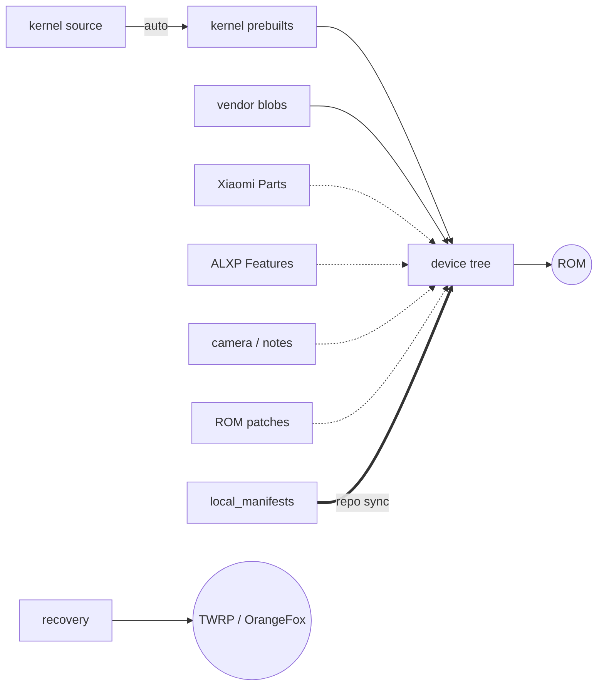

# Xiaomi Pad 8 Pro Development

Custom ROMs, kernel and recovery for the **Xiaomi Pad 8 Pro** (`piano`, Snapdragon 8 Elite).

| | |
| --- | --- |
| Android | 17 |
| Firmware | HyperOS 4 China `OS4.0.5.0.XPYCNXM` |
| Branch | `seventeen` |
| Maintainer | [@ALXP-DANIEL](https://github.com/ALXP-DANIEL) |

## How it fits



Dashed: optional.

## Get started

```
git clone https://github.com/xiaomi-pad-8-pro-development/local_manifests -b seventeen .repo/local_manifests
repo sync
```

## Repositories

| Repository | What | Path |
| --- | --- | --- |
| [device](https://github.com/xiaomi-pad-8-pro-development/android_device_xiaomi_piano) | Device tree | `device/xiaomi/piano` |
| [vendor](https://github.com/xiaomi-pad-8-pro-development/android_vendor_xiaomi_piano) | Stock blobs | `vendor/xiaomi/piano` |
| [kernel](https://github.com/xiaomi-pad-8-pro-development/android_kernel_xiaomi_piano) | alxp kernel source | — |
| [kernel prebuilts](https://github.com/xiaomi-pad-8-pro-development/android_device_xiaomi_piano-kernel) | Built kernel | `device/xiaomi/piano-kernel` |
| [auto](https://github.com/xiaomi-pad-8-pro-development/auto) | Kernel build script | — |
| [thermal](https://github.com/xiaomi-pad-8-pro-development/android_hardware_qcom_thermal) | Thermal HAL fork | `hardware/qcom-caf/thermal` |
| [Xiaomi Parts](https://github.com/xiaomi-pad-8-pro-development/android_device_xiaomi_piano-xiaomi-parts) | Pen, keyboard, display | `device/xiaomi/piano-xiaomi-parts` |
| [ALXP Features](https://github.com/xiaomi-pad-8-pro-development/android_device_xiaomi_piano-alxp-parts) | AirPods, iPhone, Mac | `device/xiaomi/piano-alxp-parts` |
| [patches](https://github.com/xiaomi-pad-8-pro-development/android_device_xiaomi_piano-patches) | ROM source patches | `device/xiaomi/piano-patches` |
| [camera](https://github.com/xiaomi-pad-8-pro-development/android_vendor_xiaomi_piano-xiaomi-camera) | Xiaomi camera | `vendor/xiaomi/piano-xiaomi-camera` |
| [Xiaomi Notes](https://github.com/xiaomi-pad-8-pro-development/android_vendor_xiaomi_piano-xiaomi-notes) | Offline Xiaomi Notes | `vendor/xiaomi/piano-xiaomi-notes` |
| [AOSP Notes](https://github.com/xiaomi-pad-8-pro-development/android_device_xiaomi_piano-aosp-notes) | Open notes app | `device/xiaomi/piano-aosp-notes` |
| [recovery](https://github.com/xiaomi-pad-8-pro-development/android_device_xiaomi_piano-recovery) | TWRP and OrangeFox | `device/xiaomi/piano` |
| [UEFI](https://github.com/xiaomi-pad-8-pro-development/android_device_xiaomi_piano-uefi) | UEFI and boot menu | — |
| [local_manifests](https://github.com/xiaomi-pad-8-pro-development/local_manifests) | Sync setup | `.repo/local_manifests` |
